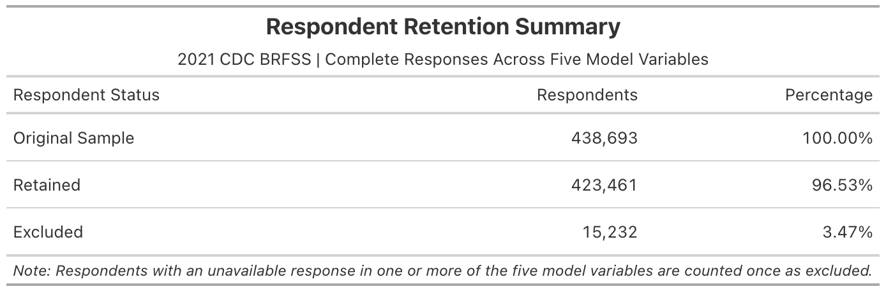

# brfss-portfolio-test
Testing Quarto report formatting for my 2021 BRFSS analysis.

|Respondent_Status | Respondents| Percentage|
|:-----------------|-----------:|----------:|
|Original Sample   |      438693|     100.00|
|Retained          |      423461|      96.53|
|Excluded          |       15232|       3.47|

Employment Status (EMPLOY1)
|Original_Code |New_Code |Description           |Action  |
|:-------------|:--------|:---------------------|:-------|
|1             |1        |Yes                   |Keep    |
|2             |0        |No                    |Keep    |
|7             |NA       |Don't know / Not sure |Exclude |
|9             |NA       |Refused               |Exclude |
|NA            |NA       |Missing               |Exclude |
